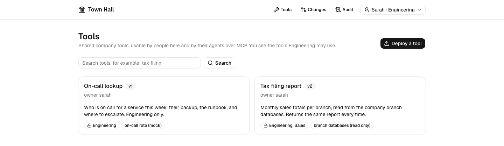
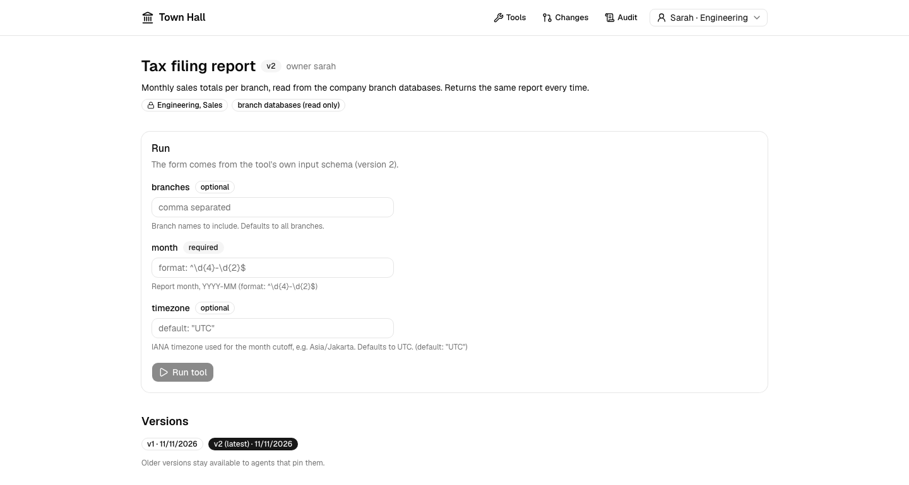
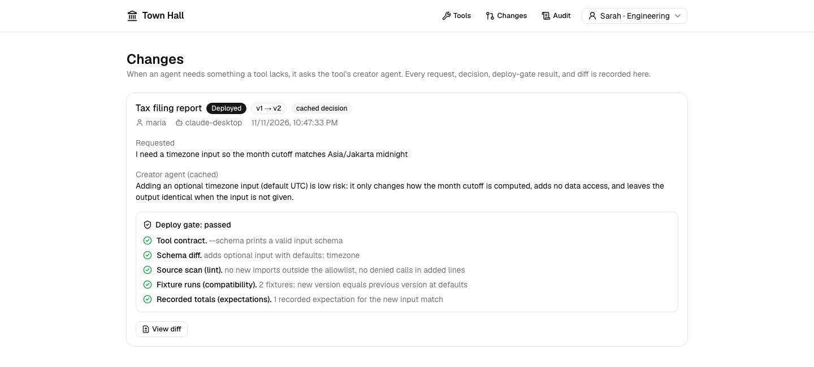
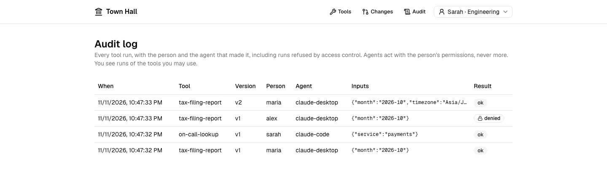
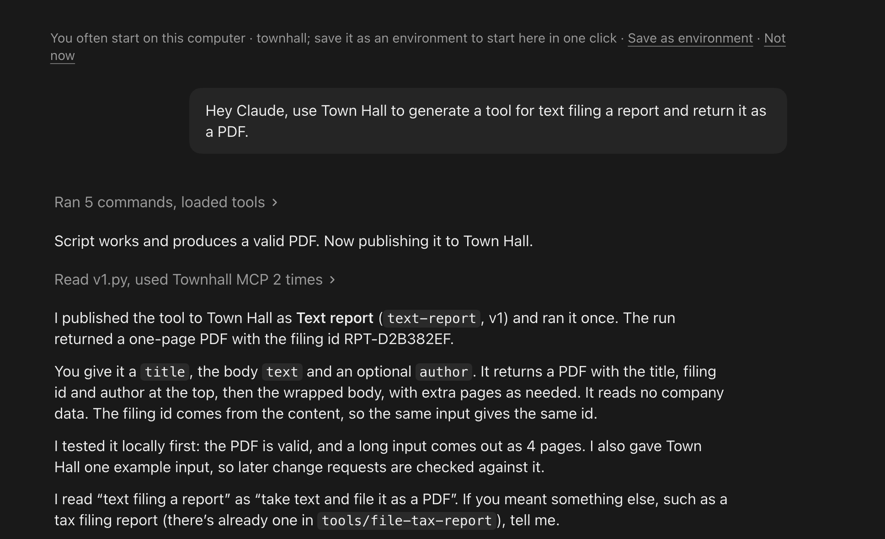
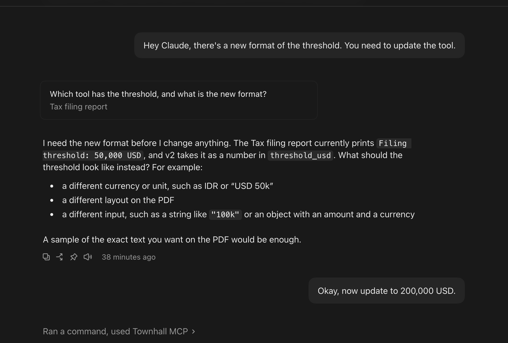

# Town Hall

**A cloud for small software.** Your agent builds a tool in an afternoon. Town Hall is where it goes so the rest of the company, and their agents, can use it: company access rules, an audit log, an owner for every tool, and changes that agents propose and a deploy gate checks.

> Everyone's agents can make internal tools, but my boss likes mine better.

**[▶ Watch the 25-second interactive tour](https://juliobellano.github.io/townhall/)**

## Why

Small internal tools are everywhere: a monthly finance report, an on-call lookup, an admin button. They get built fast, often by an agent, and then they stay on one laptop. The code isn't the hard part. Sharing is: company login, safe access to company data, hosting, and someone who owns the tool after its builder moves on.

Letting every agent regenerate its own copy doesn't fix this:

1. Generated versions drift, and company documents must come out identical every time.
2. Internal tools touch sensitive data that agents shouldn't read directly.

So Town Hall keeps one canonical, governed tool, and every person and agent uses that.

## How it works

1. **Publish.** You tell your agent "upload my workflow to Town Hall". It calls `publish_tool` over MCP. Town Hall reads the input schema from the script itself, so the spec can't drift from the code.
2. **Use.** A colleague tells their agent "use the tax filing report". The agent searches Town Hall, reads the schema, asks for any missing input, and runs it. The agent gets the result, never the raw data. People can do the same from the web UI.
3. **Govern.** Every run is logged with the person and the agent. Tools are limited to departments, and a refused run is logged too.
4. **Improve.** When a tool is missing something, the agent calls `request_change`. The tool's creator agent decides, and a deploy gate checks the new version against recorded examples before it goes live. The old version stays available.

## Screenshots

**Catalog.** Shared tools with their owner, version, who may use them, and what they read.



**Tool page.** The run form is generated from the tool's own input schema. Every version is kept.



**Changes.** An agent asked for a timezone input. The creator agent's reasoning, the five-check deploy gate, and the diff are all recorded.



**Audit log.** Every run, with the person and the agent, including runs refused by access control.



## Agents talking to agents

Agents don't only run tools, they can also fix and update them by talking to the agent that owns the tool. When a tool is missing something or is broken, the caller's agent calls `request_change` with what it needs. Town Hall passes the request to the tool's creator agent, which reasons about it and decides. If the change is good, the new version goes through the deploy gate and is deployed on the spot, and the caller's agent can use it right away. The old version stays available.

**Publish from Claude Code.** The user asks for a tool in plain words. Claude builds and tests the script, then publishes it with `publish_tool`, with one example input that guards later changes.



**Ask for a change.** The user says the threshold format changed. Claude finds the Tax filing report, asks what the new format is, then calls `request_change` with "200,000 USD". The creator agent and the deploy gate handle the rest (see the Changes screenshot above).



## The MCP

One MCP server at `/api/mcp` (streamable HTTP, stateless) with five tools:

| Tool | What it does |
|---|---|
| `search_tools` | Finds shared tools the caller may use |
| `get_tool` | Owner, access, what it touches, source code and input schema |
| `run_tool` | Runs a tool, audited with the person and the agent. Returned files (such as a PDF) come back as download links |
| `request_change` | Asks the tool's creator agent for a change; deployed only if the deploy gate passes |
| `publish_tool` | Publishes a new tool, with optional example inputs that guard later changes |

The caller is identified by the `X-Townhall-User` and `X-Townhall-Agent` headers. To connect Claude from another machine through an ngrok tunnel, see "Connecting Claude to the MCP over a tunnel" in [AGENTS.md](AGENTS.md).

## Quick start

Needs a recent Node with the built-in `node:sqlite` (developed on Node 26) and Python 3 with `zoneinfo` (developed on 3.14).

```bash
npm install
npm run demo:seed -- --fresh   # mock company data + the Tax filing report and On-call lookup tools
npm run build && npm start     # http://localhost:3000 (MCP at /api/mcp)
```

Use `npm run demo:seed -- --fresh --no-publish` to start with an empty catalog and publish the first tool from an agent. The demo run of show is in [demo/README.md](demo/README.md).

## What is real and what is a demo stand-in

Real: the MCP server, tool runs, the audit log, department access checks, the deploy gate and its example runs, versioning, files returned by tools, and the schema-driven form.

Stand-ins: company login (a hardcoded directory and identity headers, no authentication), hosting (it runs on one machine, with no scale to zero), secrets storage, and isolation (tools run as a stripped-environment subprocess with a time limit, not a sandbox).

## Commands

| Command | What it does |
|---|---|
| `npm test` | Vitest: runner, schema, gate, change flow, access, files, MCP tools, database (92 tests) |
| `npm run test:py` | Python tests for the demo report script (10 tests) |
| `npm run e2e` | Builds, starts a production server on a temp home, plays the demo with MCP clients over HTTP, checks the pages (33 checks) |
| `npm run eval:creator -- --runs 5 --threshold 4` | Reliability check for the creator agent; tells you whether to film the finale live or use the cached decision |
| `npm run demo:seed` | Seeds data and publishes the demo tools (`--fresh` resets, `--no-publish` leaves the catalog empty) |
| `npm run demo:setup` | Writes the demo Claude Code sessions' MCP configs under `demo/.runtime` |
| `npm run demo:call -- <user> <agent> <tool> '<json>'` | Plays an agent from the terminal |

## Layout

- `src/lib/town/` core library used by both the MCP and the UI: registry, runner, schema, access, deploy gate, creator agent, changes.
- `src/lib/mcp/server.ts` the five MCP tools. `src/app/api/mcp/route.ts` serves them statelessly over HTTP.
- `src/app/`, `src/components/` the web UI (shadcn/ui and lucide-react only).
- `tools/branch-report/` the Tax filing report: `v1.py`, the hand-made `v2.py`, expected totals, and the cached decision. `tools/oncall-lookup/` the On-call lookup.
- `scripts/` seed data, demo seed and setup, eval, end-to-end test.

## The tool contract

A tool is a Python script that reads JSON inputs on stdin, writes a JSON result on stdout, prints its own input JSON Schema with `--schema`, and on failure prints `{"error": "..."}` and exits non-zero. It may return files in a reserved `_files` key; Town Hall stores them and returns download links. Town Hall reads the schema from the script, so the spec cannot drift from the code.

## Creator agent backends

Copy `.env.example` to `.env.local` (gitignored) and set `ANTHROPIC_API_KEY`. `TOWNHALL_CREATOR=auto` (default) then tries, in order:

1. **GMI Cloud Router**, only if `GMI_API_KEY` is set (off by default). Mode from `GMI_ROUTER_MODE` (default `quality`); the router picks the model per call and the agent replies in tags that Town Hall parses.
2. **Anthropic API** (`ANTHROPIC_API_KEY`): Claude Sonnet 5.5 (`TOWNHALL_CREATOR_MODEL`) at `medium` effort (`TOWNHALL_CREATOR_EFFORT`), adaptive thinking, the decision returned through structured outputs, and server-side refusal fallbacks on.
3. **Claude Code CLI**, locked down (no tools, no MCP, empty temp directory).
4. **The stored cached decision**, always labeled "cached decision" in the UI.

The Changes page shows which backend and model decided (for example `api:claude-sonnet-5-5`). Live backends share a time budget (`TOWNHALL_CREATOR_TIMEOUT_MS`, default 90 s). Force one backend with `TOWNHALL_CREATOR=api|gmi|cli|cached`.

## More

[AGENTS.md](AGENTS.md) for what we are building and why, [DISCUSSION.md](DISCUSSION.md) for the pitch, and [docs/designs/town-hall-demo.md](docs/designs/town-hall-demo.md) for the approved design.
